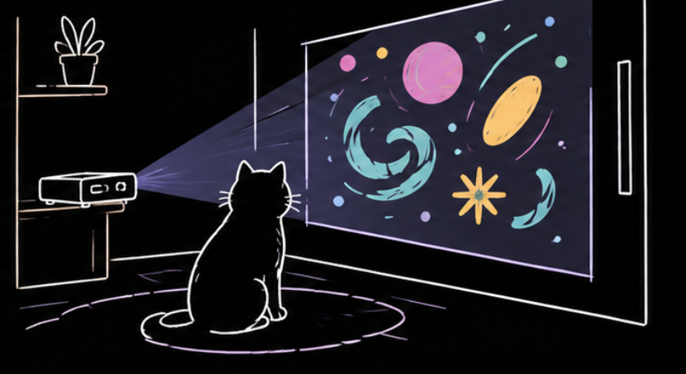

# Gimnacio-para-gatos
Un pequeño circuito electrico para entretener a nuestros gatos en casa bajo nuestra ausencia.

  

# Codigo-Arduino

const int TRIG = 9;
const int ECHO = 10;

void setup() {
  pinMode(TRIG, OUTPUT);
  pinMode(ECHO, INPUT);

  Serial.begin(9600);
}

void loop() {
  // Enviar pulso al sensor
  digitalWrite(TRIG, LOW);
  delayMicroseconds(2);

  digitalWrite(TRIG, HIGH);
  delayMicroseconds(10);
  digitalWrite(TRIG, LOW);

  // Medir el tiempo de regreso del eco
  long duracion = pulseIn(ECHO, HIGH, 30000);

  // Convertir el tiempo en centímetros
  if (duracion == 0) {
    Serial.println(999);
  } else {
    int distancia = duracion * 0.0343 / 2;
    Serial.println(distancia);
  }

  delay(100);
}

# Codigo-Processing
import processing.serial.*;
import processing.video.*;

Serial myPort;

Movie[] videos = new Movie[3];

String[] archivos = {
  "NWTD.mp4",
  "ESTIMULO.mp4",
  "NAT1.mp4"
};

int distancia = 999;
int UMBRAL = 100;
int RESET = 120;

int videoActual = -1;

boolean personaPresente = false;
boolean reproduciendo = false;

void setup() {
  size(1280, 720);
  pixelDensity(1);

  // Cargar los cuatro videos
  for (int i = 0; i < videos.length; i++) {
    videos[i] = new Movie(this, archivos[i]);
    videos[i].pause();
  }

  // Conectar Arduino
  printArray(Serial.list());

  myPort = new Serial(this, "/dev/cu.usbmodem21101", 9600);
  myPort.bufferUntil('\n');
}

// Leer los videos
void movieEvent(Movie m) {
  m.read();
}

// Leer distancia del sensor
void serialEvent(Serial p) {

  String dato = p.readStringUntil('\n');

  if (dato != null) {

    dato = trim(dato);

    try {

      distancia = int(dato);

      println("Distancia: " + distancia + " cm");

      // Detectar cuando alguien se aleja
      if (distancia == 999 || distancia > RESET) {
        personaPresente = false;
      }

      // Detectar una nueva persona
      if (distancia > 0 &&
          distancia != 999 &&
          distancia <= UMBRAL) {

        if (!personaPresente) {

          personaPresente = true;

          // Detener video anterior
          if (videoActual >= 0) {
            videos[videoActual].pause();
            videos[videoActual].jump(0);
          }

          // Pasar al siguiente video
          videoActual++;

          if (videoActual >= videos.length) {
            videoActual = 0;
          }

          // Reproducir inmediatamente el nuevo video
          videos[videoActual].jump(0);
          videos[videoActual].play();

          reproduciendo = true;

          println("Reproduciendo: " + archivos[videoActual]);
        }
      }

    } catch (Exception e) {
      println("Error leyendo distancia");
    }
  }
}

// Mostrar video
void draw() {

  background(0);

  if (videoActual >= 0 && reproduciendo) {

    Movie video = videos[videoActual];

    if (video.width > 0) {
      image(video, 0, 0, width, height);
    }

    // Detectar final del video
    if (video.duration() > 0 &&
        video.time() >= video.duration() - 0.1) {

      video.pause();
      video.jump(0);

      reproduciendo = false;

      println("Video finalizado. Esperando siguiente persona.");
    }
  }
}
[2:23 p.m., 4/11/2026] +57 319 2188294: ARDUINO
[2:23 p.m., 4/11/2026] +57 319 2188294: const int TRIG = 9;
const int ECHO = 10;

void setup() {
  pinMode(TRIG, OUTPUT);
  pinMode(ECHO, INPUT);

  Serial.begin(9600);
}

void loop() {

  digitalWrite(TRIG, LOW);
  delayMicroseconds(2);

  digitalWrite(TRIG, HIGH);
  delayMicroseconds(10);
  digitalWrite(TRIG, LOW);

  long duracion = pulseIn(ECHO, HIGH, 30000);

  if (duracion == 0) {
    Serial.println(999);
  } else {
    int distancia = duracion * 0.0343 / 2;
    Serial.println(distancia);
  }

  delay(100);
}

# Proceso

1. Conecta el Arduino por USB.
2. En Arduino IDE, selecciona Arduino Uno en el menú de placas y el puerto COM correspondiente.
3. Pulsa el botón de subir código (la flecha hacia la derecha).
4. Espera a que termine la carga.Este programa mide la distancia y envía un número por USB cada 100 milisegundos. Por ejemplo, 45 significa que el objeto está aproximadamente a 45 cm; 999 indica que no se recibió un eco válido dentro del tiempo de espera
5. ¿Cómo se conecta este código con el de Processing?Ahora viene la parte interesante. Tu código original ya tiene casi toda la lógica necesaria.

# Operaciones

| | |
|---|---|
| **Parte del codigo** | ¿Que hace? |
| **import processing.serial.*;** | Permite comunicarse con Arduino.|
| **import processing.video.*;** | Permite cargar y reproducir videos. |
| **Serial.begin(9600) en Arduino** | Establece la velocidad de comunicación. |
| **new Serial(this, COM1, 9600)** | Abre el puerto de Arduino en Processing. |
| **THRESHOLD = 100** | Establece el límite de activación en 100 cm. |
| **val <= THRESHOLD** | Comprueba si el objeto está a 100 cm o menos. |
| **mov.jump(0)** | Lleva el video al inicio. |
| **mov.loop()** |Reproduce el video en bucle. |
| **mov.pause()** | Pausa el video cuando el objeto se aleja. |

# Hardware
| | |
|---|---|
| **Componente** | especificación |
| **Arduino** |  Arduino UNO R3 |
| **Sensor de proximidad** | HC-SR04 |
| **Proyector** | sin establecer |

# Agradecimientos
Mil gracias al equipo de trabajo, al Profesor Renzo rospligliosi, y a la clase por el acompañamiento en este proceso de aprendizaje.

# Contactos
Ricardo Pinzon Garcia
[rick_richi_rich](https://www.instagram.com/rick_richi_rich/)
Bogotá, Colombia

Ruben Perez
[renderdraw95](https://www.instagram.com/renderdraw95/)
Bogotá, Colombia

Nathalia Alba Miranda
[Nathalia_Alba](https://www.instagram.com/renderdraw95/)
Bogotá, Colombia

